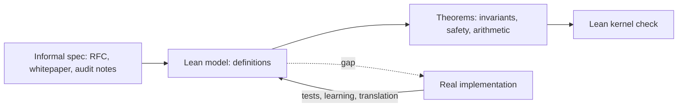

# Why Proofs for Security Engineers

Testing, fuzzing and auditing all sample behaviour. They try inputs, read code paths, and look for counterexamples. A proof covers every input at once. For a small, critical piece of logic, such as "a handshake cannot reach the established state without a Finished message", "this addition never silently overflows", or "this circuit constraint forces the output to be a bit", a machine-checked proof removes doubt that no amount of testing can remove. This book shows security engineers how to write such proofs in Lean 4.

## What Lean 4 is

Lean 4 is a functional programming language and an interactive theorem prover. You write definitions (functions, data types) and theorems about them. Lean's **kernel**, a small type checker, verifies every proof. If the kernel accepts a proof, the theorem is true relative to Lean's logic and the definitions you wrote. **Mathlib** is the large community library of formalised mathematics for Lean, covering algebra, number theory, finite fields and much more.

Lean has three properties that matter for security work:

- **Programs and proofs live together.** You can write the model of a protocol as ordinary Lean functions, run it with `#eval`, and prove theorems about the same code.
- **Small trusted kernel.** Tactics, automation and AI tools can generate proofs, but only the kernel decides. A bug in a tactic cannot make a false theorem accepted; at worst the tactic fails.
- **Transparent assumptions.** `#print axioms` lists exactly which axioms a theorem depends on, including the placeholder axiom introduced by unfinished proofs (`sorry`).

## Where proofs fit in a security programme

| Question | Best tool |
|---|---|
| Does this binary crash on weird inputs? | fuzzing (see **ai-fuzzing-field-guide**) |
| Does this implementation match the spec on known edge cases? | test vectors and differential testing (see **crypto-implementation-testing**) |
| Does this protocol design have an attack? | protocol verifiers such as Tamarin or ProVerif |
| Is this small piece of logic correct for all inputs? | theorem proving, including Lean |
| Does this Rust or Solidity code satisfy its spec? | code-level verifiers (see **rust-formal-verification**, **neurosymbolic-contract-verification**) |

Lean is general purpose. It is not the fastest route to verifying a large existing codebase, but it is excellent for models: protocol state machines, invariants of a smart contract's accounting, arithmetic lemmas and constraint systems for zero-knowledge circuits.

## The model gap

Every proof in this book is about a **model**. If you prove that a Lean model of a handshake is safe, you have not proved that OpenSSL is safe. The gap between model and implementation is closed in one of three ways:

1. **Testing the implementation against the model.** Generate traces from the model and replay them, or learn the implementation's state machine and compare it with your model (see **protocol-state-machine-learning**).
2. **Translating code into Lean.** Tools such as Aeneas translate a subset of safe Rust into Lean so the proof is about the actual code (chapter 6).
3. **Writing the implementation in Lean.** Lean compiles to C, so for some components the verified model can be the implementation.

Being explicit about which of these applies is part of writing an honest proof.



## AI and proofs

Language models are now useful proof assistants: they suggest tactics, fill in routine steps and translate informal arguments into Lean. Lean is a natural partner because the kernel checks every suggestion. A model cannot talk its way past the kernel. The model proposes, the kernel decides. Two weaknesses remain: a model may "prove" a theorem by weakening the statement, and it may leave `sorry` or add axioms. Chapter 6 covers how to catch both.

## What this book covers

1. Why proofs (this chapter).
2. Lean 4 basics for security engineers.
3. Modelling state machines and proving invariants.
4. Arithmetic, overflow and smart contract accounting.
5. Circuit constraint soundness.
6. AI proof assistance, Aeneas and Verus, limits and a checklist.

All code in chapters 2 to 5 that uses only core Lean was compiled with Lean 4.35.0 while writing this book. Examples that need Mathlib are marked as not compiled here.

## Worked example

Install Lean and check your first theorem. These steps were executed while writing this book (Lean 4.35.0 on Linux).

1. Install the Lean version manager `elan` using the installer script linked from the Lean website (`lean-lang.org`), then confirm with `lean --version`.
2. Create `First.lean`:

```lean
def double (n : Nat) : Nat := n + n

theorem double_eq (n : Nat) : double n = 2 * n := by
  unfold double
  omega

#print axioms double_eq
```

3. Run `lean First.lean`. No errors means the kernel accepted the proof; the last line lists the axioms the theorem depends on.
4. Change `2 * n` to `3 * n` and rerun. Lean reports that `omega` could not prove the goal.
5. Replace the proof with `sorry` and rerun. Lean prints a warning that the declaration uses `sorry`, and exits with status 0. Rerun with `lean -DwarningAsError=true First.lean` and observe a non-zero exit status. This is how CI should run.

## Common pitfalls

- Treating a proof about a model as a proof about the implementation.
- Accepting files that compile with `sorry` warnings because the exit status was zero.
- Proving a weaker statement than intended and not noticing, especially with AI help.
- Choosing a model so abstract that the property is trivially true.
- Starting with a large existing codebase instead of a small, critical component.

## Exercises

1. Install Lean, run the worked example, and record the output of `#print axioms` before and after inserting `sorry`.
2. List three properties from a system you know (a protocol, a contract, a circuit) that are small enough to state in one sentence each, and say how you would close the model gap for each.
3. Read the "Theorem Proving in Lean 4" introduction and summarise the role of the kernel in two sentences.

## Further reading

- [Lean language website](https://lean-lang.org/)
- [Theorem Proving in Lean 4](https://lean-lang.org/theorem_proving_in_lean4/)
- [Mathlib](https://github.com/leanprover-community/mathlib4)
- de Moura, Ullrich, "The Lean 4 Theorem Prover and Programming Language", CADE 2021.
- **rust-formal-verification** and **neurosymbolic-contract-verification**
