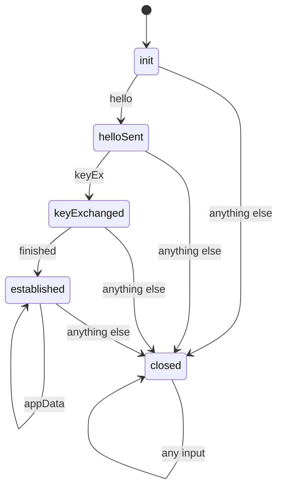

# Modelling State Machines and Proving Invariants

Most security properties of protocols and contracts are statements about every reachable state: "no message is accepted after an alert", "application data is only accepted after the handshake completes", "total supply never changes except through mint and burn". This chapter shows how to model a system as a state machine in Lean and prove such properties for all traces, not just the ones you thought to test.

## The pattern

Every model in this chapter has the same shape:

| Piece | Lean form |
|---|---|
| States | an inductive type or a structure |
| Inputs | an inductive type of messages or calls |
| Transition | a total function `step : State → Input → State` (or returning `Option State` for reverts) |
| Traces | `run : State → List Input → State` folding `step` over a list |
| Property | a theorem quantified over all input lists |

Because `step` is total, every possible input in every state has a defined result. There is no "we did not consider that case": Lean refuses to compile a `match` with missing cases.



## A toy handshake

```lean
inductive State where
  | init | helloSent | keyExchanged | established | closed
  deriving DecidableEq, Repr

inductive Msg where
  | hello | keyEx | finished | appData | alert
  deriving DecidableEq, Repr

def step : State → Msg → State
  | .init,         .hello    => .helloSent
  | .helloSent,    .keyEx    => .keyExchanged
  | .keyExchanged, .finished => .established
  | .established,  .appData  => .established
  | _,             _         => .closed

def run (s : State) : List Msg → State
  | []      => s
  | m :: ms => run (step s m) ms
```

The final wildcard case sends every unexpected message to `closed`. This is the strict design that state machine learning studies found correct implementations converge on (see **protocol-state-machine-learning**).

## Three properties

**Closed is absorbing.** Once closed, nothing reopens the connection.

```lean
theorem closed_absorbing (ms : List Msg) : run .closed ms = .closed := by
  induction ms with
  | nil => rfl
  | cons m ms ih => cases m <;> simpa [run, step] using ih
```

**Application data is only accepted in the established state.** A one-step property, proved by case analysis on all states.

```lean
theorem appData_needs_established (s : State)
    (h : step s .appData = .established) : s = .established := by
  cases s <;> simp_all [step]
```

**No trace reaches established without a Finished message.** This is a property of whole traces, and needs a strengthened induction hypothesis: we generalise over the starting state.

```lean
theorem established_needs_finished (ms : List Msg) :
    ∀ s, run s ms = .established → s = .established ∨ .finished ∈ ms := by
  induction ms with
  | nil => intro s h; left; simpa [run] using h
  | cons m ms ih =>
    intro s h
    rcases ih (step s m) (by simpa [run] using h) with h1 | h1
    · cases s <;> cases m <;> simp_all [step]
    · right; simp [h1]

theorem handshake_sound (ms : List Msg) (h : run .init ms = .established) :
    .finished ∈ ms := by
  rcases established_needs_finished ms .init h with h1 | h1
  · cases h1
  · exact h1
```

The helper lemma says: if a trace ends established, either we started there, or `finished` occurs in the trace. Starting from `init`, the first option is impossible (`cases h1` closes it because `init ≠ established`).

## Generalising the induction

The most common difficulty in trace proofs is an induction hypothesis that is too weak. Proving `handshake_sound` directly by induction fails, because after one step the start state is no longer `init`. The fix, used above, is to prove a statement for **all** start states and specialise later. Write the general lemma first whenever a property talks about a specific initial state.

## Invariants

For larger systems, state an **invariant** `Inv : State → Prop`, then prove:

1. `Inv init` (holds initially);
2. `∀ s m, Inv s → Inv (step s m)` (preserved by every step).

A simple induction over traces then gives `Inv (run init ms)` for every `ms`. The art is choosing an invariant strong enough to be preserved. If preservation fails, Lean shows the exact state and input that break it, which is often a real design bug or a sign the invariant needs another conjunct.

## Modelling choices that matter

- **Who sends what.** For two-party protocols, model each side's state and a network that can drop, reorder or inject messages. A model with a perfectly reliable network proves less.
- **Adversary inputs.** Include an attacker message constructor (for example `.attackerInjects payload`) so theorems quantify over attacker behaviour.
- **Reverts.** For contracts, `step : State → Call → Option State`, with `none` as revert, mirrors EVM semantics.

## Worked example

Prove the handshake properties, then break the model and watch the proofs fail. Executed while writing this book with Lean 4.35.0; the code in this chapter is the exact file that compiled.

1. Put all definitions and theorems from this chapter in `Handshake.lean`, followed by `#eval run .init [.hello, .appData]` and `#print axioms handshake_sound`.
2. Run `lean Handshake.lean`. It compiled without errors, the `#eval` printed `State.closed`, and the axiom list was `[propext]`.
3. Introduce a bug: add the line `| .helloSent, .appData => .established` before the wildcard case in `step`.
4. Rerun. Lean reported unsolved goals in `appData_needs_established` (case `helloSent`, goal `False`) and in `established_needs_finished` (case `helloSent`, `appData`, goal `Msg.finished ∈ ms`). The `#eval` now printed `State.established`.
5. Note that `#print axioms handshake_sound` now included `sorryAx`: Lean replaces failed proofs with `sorry` to keep going. Errors still make `lean` exit non-zero, but always check the axiom list too.

## Common pitfalls

- Proving trace properties without generalising the start state, then getting stuck.
- Models where the network is reliable and honest, so attacker behaviour is never considered.
- Using non-exhaustive "default" cases that silently accept unexpected inputs instead of closing.
- Invariants that are true but not inductive (not preserved by a single step without extra conjuncts).
- Forgetting that the theorem is about the model; replay model traces against the implementation.

## Exercises

1. Add an `alert` rule that is allowed from any state and prove that after an alert every further input leaves the machine closed.
2. Model a two-party version with client and server states and a list of in-flight messages, and prove that the server never reaches `established` unless the client sent `finished`.
3. Define an invariant for the toy handshake (for example, "if state is established then the trace so far contains keyEx") and prove it with the init-and-preservation pattern.

## Further reading

- [Theorem Proving in Lean 4](https://lean-lang.org/theorem_proving_in_lean4/), chapters on induction and tactics.
- Lamport, "Specifying Systems", 2002, on invariants and state machines (TLA+, but the ideas transfer).
- **protocol-state-machine-learning** for learning real implementations' state machines to compare with models.
