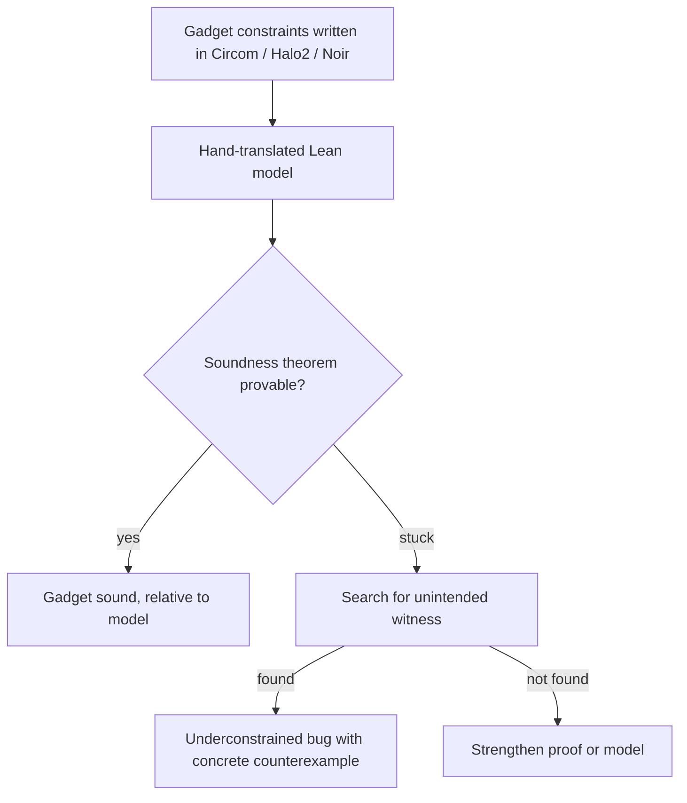

# Circuit Constraint Soundness

Zero-knowledge circuits express computations as systems of polynomial constraints over a finite field. A prover convinces a verifier that it knows values (a witness) satisfying the constraints. The most common and dangerous circuit bug is an **underconstrained** circuit: the constraints accept witnesses the designer never intended, so a malicious prover can prove false statements. This chapter shows how to state and prove soundness for small gadgets in Lean, which catches exactly that bug class.

## Soundness and completeness for gadgets

For a gadget meant to compute a function `f`:

| Property | Statement | Bug if missing |
|---|---|---|
| Soundness | every witness satisfying the constraints has `out = f(in)` | underconstrained: prover can choose a wrong `out` |
| Completeness | for every input there is a satisfying witness with `out = f(in)` | honest provers cannot prove true statements |

Soundness is the security property. Completeness is a liveness property that tests usually catch. Lean is most valuable for soundness, because finding an unintended witness by testing requires guessing it.

## Fields: the modelling choice

Real circuits work in a prime field such as the BN254 scalar field. In Mathlib this is `ZMod p` with a proof that `p` is prime, and field facts (no zero divisors, inverses) come from Mathlib's algebra library. For learning, many gadget arguments only need "no zero divisors", which also holds in the integers, so you can prototype in core Lean with `Int` and port to `ZMod p` later. Be careful: some facts true in `Int` are false in a finite field (ordering, size of values, `x + 1 > x`), so range checks and comparisons must be modelled in the field.

## A bit constraint

The constraint `x * (x - 1) = 0` is meant to force `x` to be 0 or 1:

```lean
theorem bool_constraint (x : Int) (h : x * (x - 1) = 0) : x = 0 ∨ x = 1 := by
  rcases Int.mul_eq_zero.mp h with h0 | h1
  · exact Or.inl h0
  · right; omega
```

The Mathlib version over a prime field has the same shape (not compiled for this book; Mathlib names can change, so check its documentation):

```lean
-- requires: import Mathlib
theorem bool_constraint_zmod {p : ℕ} [Fact p.Prime] (x : ZMod p)
    (h : x * (x - 1) = 0) : x = 0 ∨ x = 1 := by
  rcases mul_eq_zero.mp h with h | h
  · exact Or.inl h
  · exact Or.inr (sub_eq_zero.mp h)
```

## The IsZero gadget

A classic gadget computes `out = 1` if `x = 0`, else `out = 0`, using a helper witness `inv` (the prover supplies `x⁻¹` when `x ≠ 0`). Constraints, as in circomlib's `IsZero`:

1. `out = 1 - x * inv`
2. `x * out = 0`

Soundness proof:

```lean
theorem isZero_sound (x inv out : Int)
    (h1 : out = 1 - x * inv) (h2 : x * out = 0) :
    (x = 0 → out = 1) ∧ (x ≠ 0 → out = 0) := by
  constructor
  · intro hx; subst hx; simpa using h1
  · intro hx
    rcases Int.mul_eq_zero.mp h2 with h | h
    · exact absurd h hx
    · exact h
```

Both constraints are needed. If you drop constraint 1, a prover with `x = 0` may set `out = 0`, which satisfies `x * out = 0`:

```lean
example : ∃ out : Int, (0 : Int) * out = 0 ∧ out ≠ 1 := ⟨0, by decide, by decide⟩
```

That `example` is a machine-checked counterexample: a concrete unintended witness. Writing such witnesses is how you document an underconstrained bug in a report.



## From gadgets to circuits

Real circuits compose many gadgets. Soundness composes if each gadget's soundness lemma is stated in terms of its outputs, and the circuit's theorem chains them. Range checks, bit decompositions and comparisons need care, because they rely on the field size: a decomposition of `x` into `n` bits is only unique if `2^n < p`. These side conditions are exactly where real bugs have appeared, so state them explicitly as hypotheses.

## Tooling beyond hand translation

Hand translation from Circom or Halo2 into Lean is error-prone. Research and industry projects have built extractors and verified DSLs that produce Lean or Coq models from circuit code, and specialised tools search for underconstrained signals automatically (for example, Picus for Circom using SMT). Use them where they fit, and keep hand-written Lean for critical gadgets and for documenting findings. See **zk-circuit-security** for the wider circuit audit workflow.

## Worked example

Prove the IsZero gadget sound and show the counterexample when a constraint is removed. Executed while writing this book with Lean 4.35.0; the core-Lean code in this chapter is the exact file that compiled. The Mathlib `ZMod` version was not compiled here; verify it locally in a Mathlib project.

1. Create `Circuit.lean` with `bool_constraint`, `isZero_sound` and the counterexample `example`.
2. Run `lean Circuit.lean`. It compiled with no errors.
3. Delete hypothesis `h1` from `isZero_sound` and rerun. The first conjunct (`x = 0 → out = 1`) can no longer be proved; read Lean's goal display.
4. Write the corresponding Circom template locally (two constraints, as above), compile it with `circom`, and generate a witness for `x = 0`, `out = 0` with the second constraint only, to see that the real tool accepts the unintended witness too.
5. Restore both constraints and confirm the witness from step 4 is rejected.

Steps 4 and 5 were not executed for this book; verify locally.

## Common pitfalls

- Proving soundness over `Int` and forgetting facts that fail in a finite field, such as ordering and the uniqueness of bit decompositions.
- Translating constraints into Lean incorrectly; compare each Lean hypothesis with the circuit source.
- Proving completeness and mistaking it for soundness.
- Omitting side conditions such as `2^n < p` from range-check lemmas.
- Treating "Lean proof compiles" as "circuit is safe" when the proof is about a hand-written model.

## Exercises

1. Remove `h1` from `isZero_sound`, prove instead that the weakened statement is false by giving a counterexample, and explain the attack in one paragraph.
2. Model a 2-bit decomposition gadget (`x = b0 + 2*b1`, both bits constrained) over `Int` and prove `x ∈ {0, 1, 2, 3}`.
3. In a Mathlib project, port `isZero_sound` to `ZMod p` with `[Fact p.Prime]` and compile it.

## Further reading

- [circomlib](https://github.com/iden3/circomlib) (`IsZero` and comparators)
- Pailoor et al., "Automated Detection of Under-Constrained Circuits in Zero-Knowledge Proofs", PLDI 2023 (Picus).
- [Mathlib documentation for ZMod](https://leanprover-community.github.io/mathlib4_docs/)
- **zk-circuit-security**
