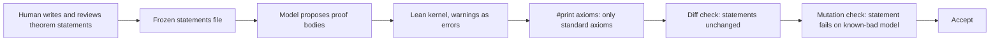

# AI Proof Assistance, Aeneas, Verus and the Limits of Proof

The final chapter covers three things: how to use AI tools to write Lean proofs safely, how Lean relates to code-level verifiers for Rust (Aeneas and Verus), and what proofs cannot give you. It ends with a checklist for running proofs as part of a security programme and some research directions.

## AI proof assistance

Language models suggest tactics, complete routine cases, find library lemmas and translate informal arguments into Lean. LeanDojo (Yang et al., NeurIPS 2023 Datasets and Benchmarks) provided tooling and a retrieval-augmented prover for Lean, and Google DeepMind's AlphaProof (announced in 2024) produced Lean proofs for competition problems.

The reason AI and Lean fit well is the kernel. Every suggested proof is checked; an invalid one simply fails. But three failure modes survive the kernel:

| Failure | How it happens | Tool check |
|---|---|---|
| Unfinished proof | model leaves `sorry` | `lean -DwarningAsError=true` fails; `#print axioms` shows `sorryAx` |
| Extra assumptions | model adds an `axiom` or a hypothesis that makes the theorem trivial | `#print axioms` lists custom axioms; diff the theorem statement against the reviewed version |
| Wrong statement | model proves a weaker or different theorem | statement review by a human; tests that the statement fails on a known-buggy model |

The third is the most important. A model asked to prove "the handshake never accepts data before Finished" might quietly prove something about a different function, or add a hypothesis that excludes the interesting traces. The defence is procedural: theorem statements are written or reviewed by humans and frozen; the model may only change proof bodies; CI checks that statements are unchanged.

## Independent checking

For high-assurance results, re-check compiled proofs outside the elaborator. The Lean 4.35.0 toolchain used for this book ships `leanchecker`, which replays declarations through the kernel, alongside community-written alternative kernels (`lean4lean`, `nanoda_bin`). This guards against metaprograms, including model-written tactics, manipulating the environment.

## Lean and Rust: Aeneas

Aeneas (Son Ho and Jonathan Protzenko, ICFP 2022) translates a subset of safe Rust, via the Charon front end, into pure functional models in Lean and other provers. Rust's ownership discipline lets the translation avoid a memory model, so you prove properties of an automatic translation of the real code instead of a hand-written model. Limits: supported Rust features (check current documentation) and trust in the translation.

## Verus

Verus (Lattuada et al., OOPSLA 2023) writes specifications and proofs in Rust syntax next to the code and discharges them with an SMT solver. It is more automated for code-level properties; Lean is more expressive and has Mathlib. Teams often use Verus or Aeneas for code and Lean for mathematics and protocol models. See **rust-formal-verification**.

| Tool | Proof style | Strength | Typical security use |
|---|---|---|---|
| Lean 4 + Mathlib | interactive, tactics | expressiveness, mathematics library | protocol models, arithmetic lemmas, circuit soundness |
| Aeneas | translate Rust to Lean, prove in Lean | proofs about real Rust code | verified Rust components |
| Verus | annotations in Rust, SMT | automation, close to code | systems code invariants |

## Limits of proof

- **Model gap.** Unless you prove the actual code (Aeneas, verified compilation), proofs are about models.
- **Specification errors.** A proof that the wrong property holds is worthless. Mutation checks and peer review are the defence.
- **Trusted base.** Lean's kernel, the axioms used, the translation tools, and the compiler for the deployed code.
- **Out-of-model attacks.** Side channels, gas limits, MEV ordering and economic attacks are outside most models unless explicitly modelled.
- **Cost.** Proofs take expert time. Spend it on small, critical, stable components.

## Checklist

- [ ] Critical property stated in one sentence, then in Lean, reviewed by a second person.
- [ ] Model gap documented: hand model, translation (Aeneas) or implementation in Lean.
- [ ] CI runs `lean` (or `lake build`) with warnings as errors.
- [ ] `#print axioms` for each main theorem shows only standard axioms.
- [ ] Theorem statements frozen; AI may only change proof bodies; CI diff check enforces it.
- [ ] Each main theorem fails on at least one deliberately buggy model (mutation check).
- [ ] Optional independent re-check with `leanchecker` for release artefacts.
- [ ] Implementation tested against the model: replayed traces, property tests, learned state machines.

## Research directions

- Extracting Lean models from Solidity, Circom and Halo2 with translation validation.
- AI-written specifications checked for adequacy by mutation testing, and AI proof repair after code changes, with the kernel as judge.

## Worked example

Set up the CI gates for AI-assisted proofs. The `lean -DwarningAsError=true` and `#print axioms` behaviour below was executed with Lean 4.35.0; the shell script was not executed; verify locally.

1. Create `Sorry.lean` containing `theorem too_good (a b : Nat) : a + b = a := by sorry` and `#print axioms too_good`.
2. Run `lean Sorry.lean; echo $?`. Observed: a warning that the declaration uses `sorry`, the axiom list `[sorryAx]`, and exit status 0.
3. Run `lean -DwarningAsError=true Sorry.lean; echo $?`. Observed: an error and exit status 1.
4. Write a CI script that runs every file with warnings as errors, greps `#print axioms` output for anything other than `propext`, `Classical.choice` and `Quot.sound`, and compares a hash of all theorem statement lines with a committed reference.
5. Let a model attempt proofs for the exercises in chapters 3 to 5, and accept only those that pass all gates.

## Common pitfalls

- Trusting a green build without checking for `sorry` warnings.
- Letting a model edit theorem statements as well as proofs.
- Assuming Aeneas or Verus proofs cover unsafe code or features they do not support.
- Not recording toolchain versions; Lean and Mathlib change quickly, so pin them.
- Spending proof effort on code that changes weekly.

## Exercises

1. Implement the CI script from the worked example and test it with a file containing `sorry`, one with a custom `axiom`, and one that is clean.
2. Ask a model to prove `transfer_conserves` from chapter 4 starting from a statement with an extra hypothesis that makes it trivial; check whether your diff gate catches it.
3. Read the Aeneas tutorial, translate a small Rust function (for example a checked addition), and prove one property about it in Lean.

## Further reading

- Ho, Protzenko, "Aeneas: Rust Verification by Functional Translation", ICFP 2022.
- Lattuada et al., "Verus: Verifying Rust Programs using Linear Ghost Types", OOPSLA 2023.
- Yang et al., "LeanDojo: Theorem Proving with Retrieval-Augmented Language Models", NeurIPS 2023.
- [Aeneas](https://github.com/AeneasVerif/aeneas) and [Verus](https://github.com/verus-lang/verus)
- **rust-formal-verification**, **neurosymbolic-contract-verification**
